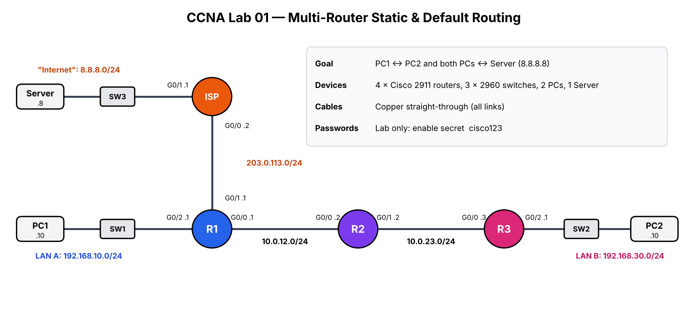
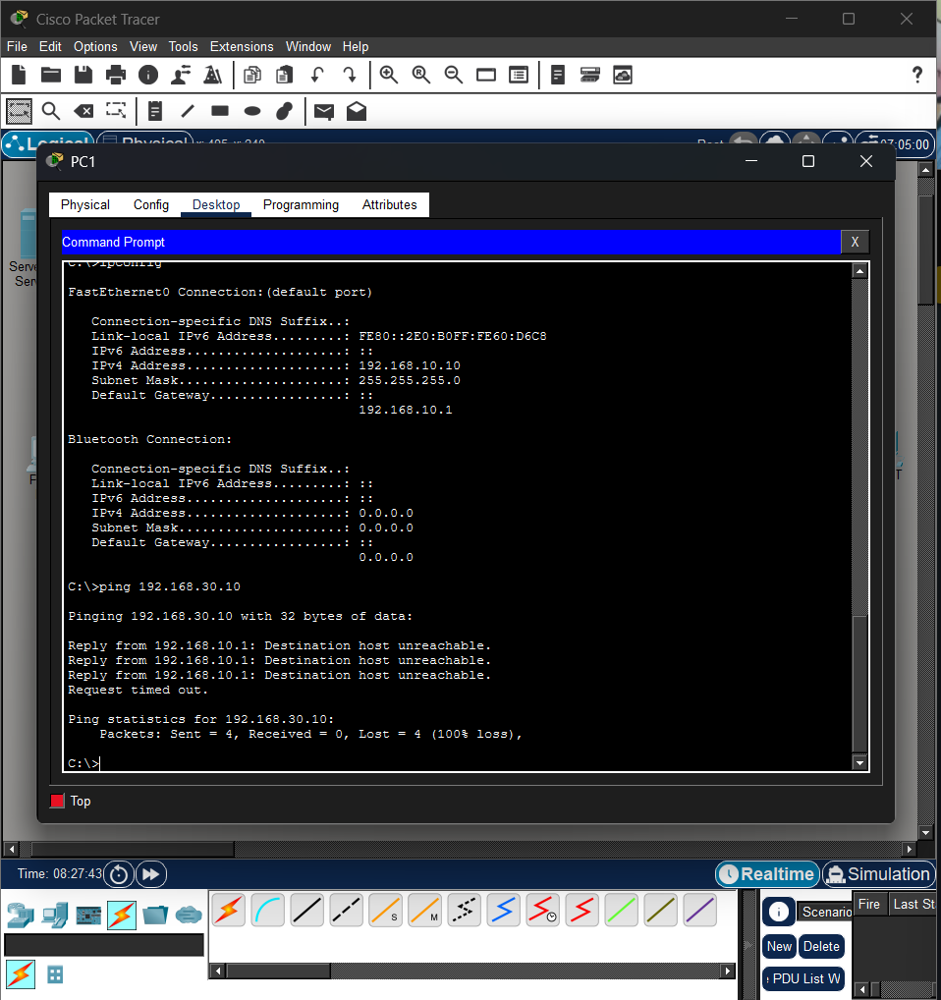
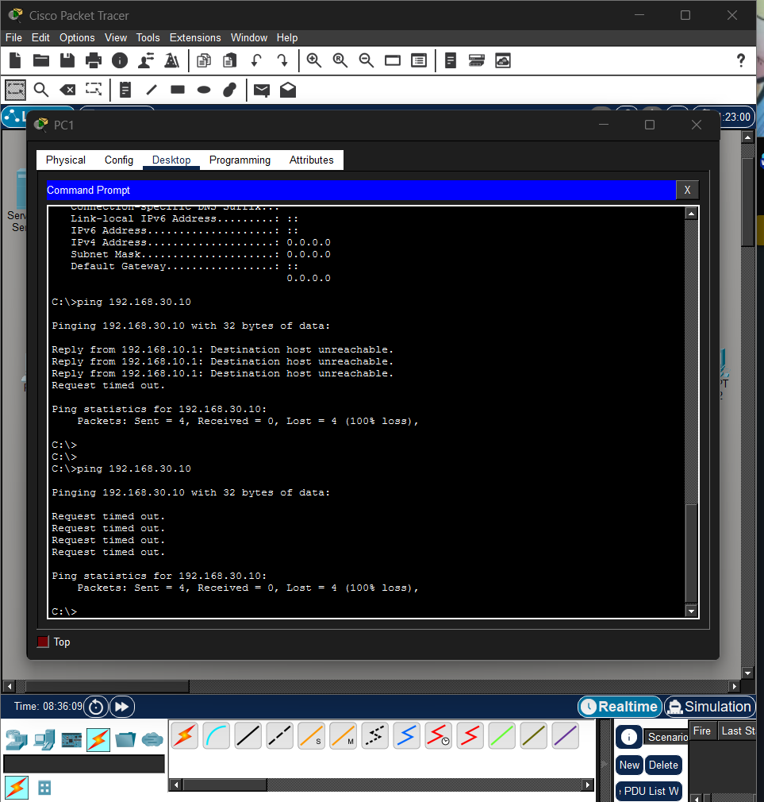
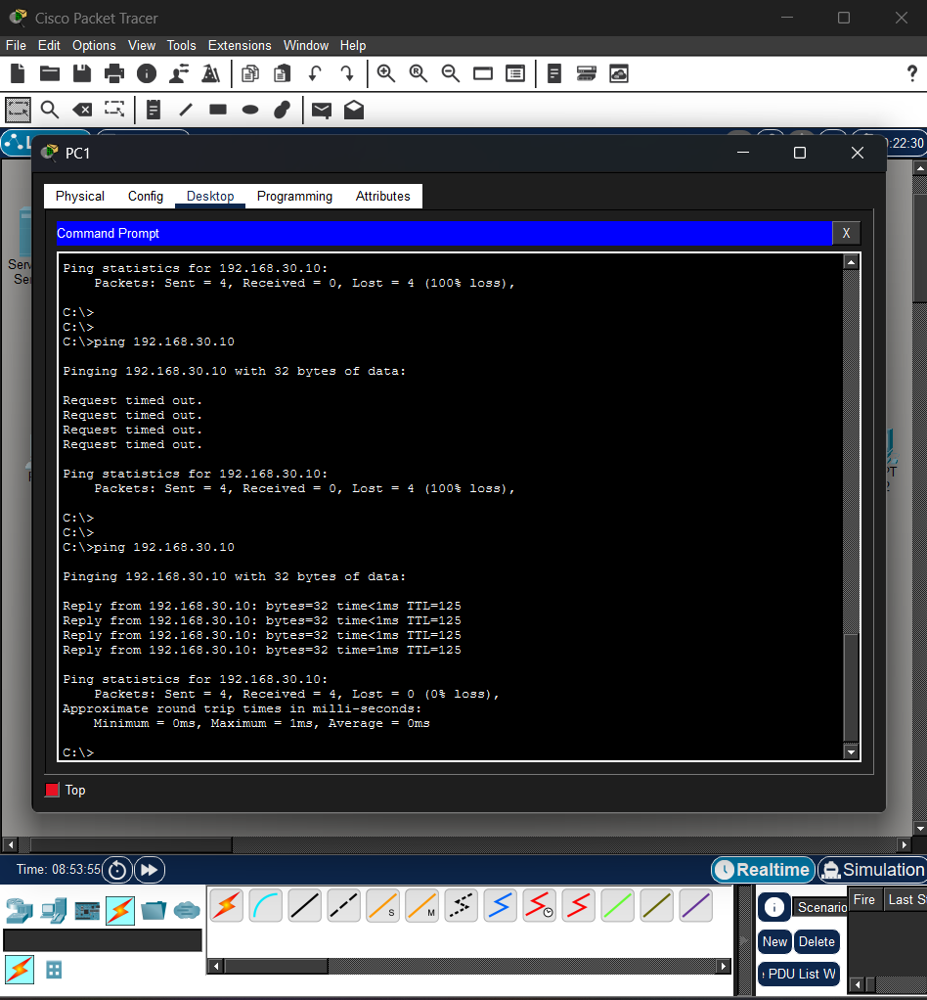
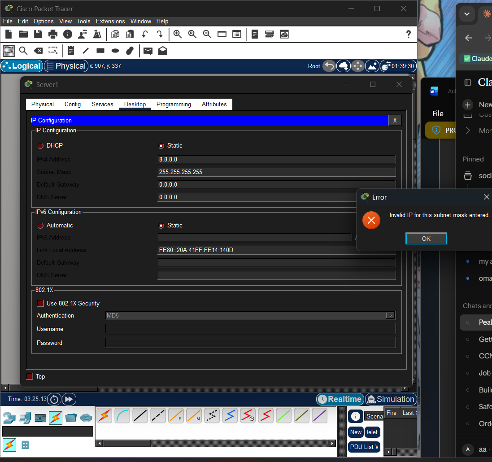
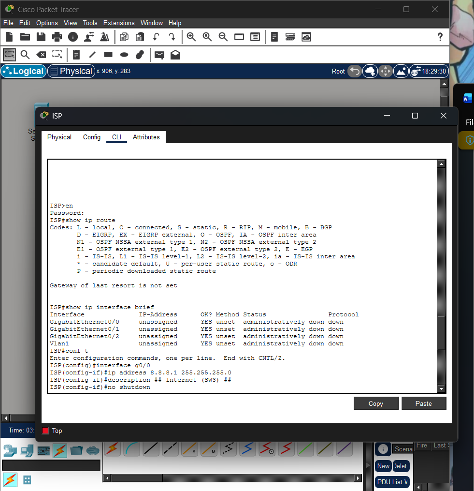
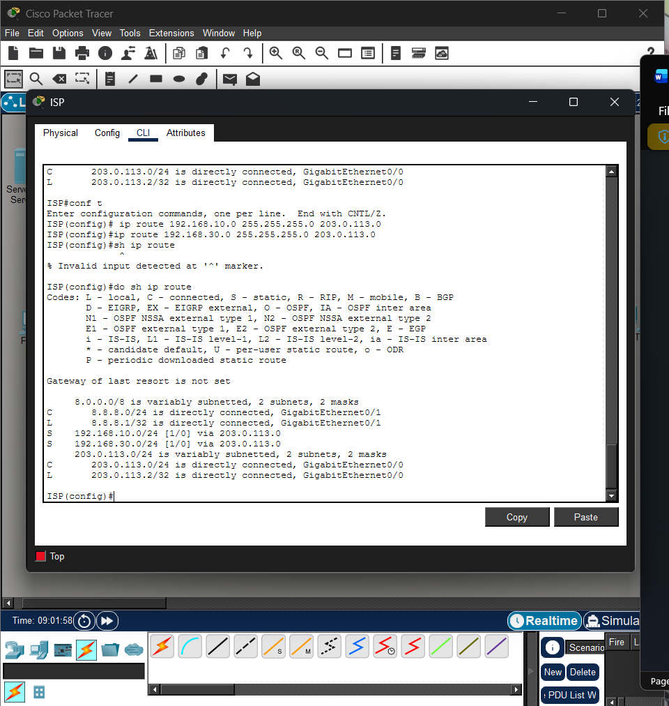
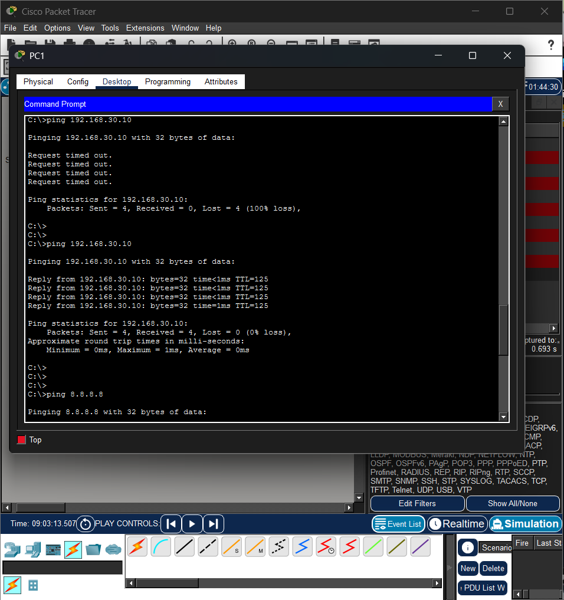
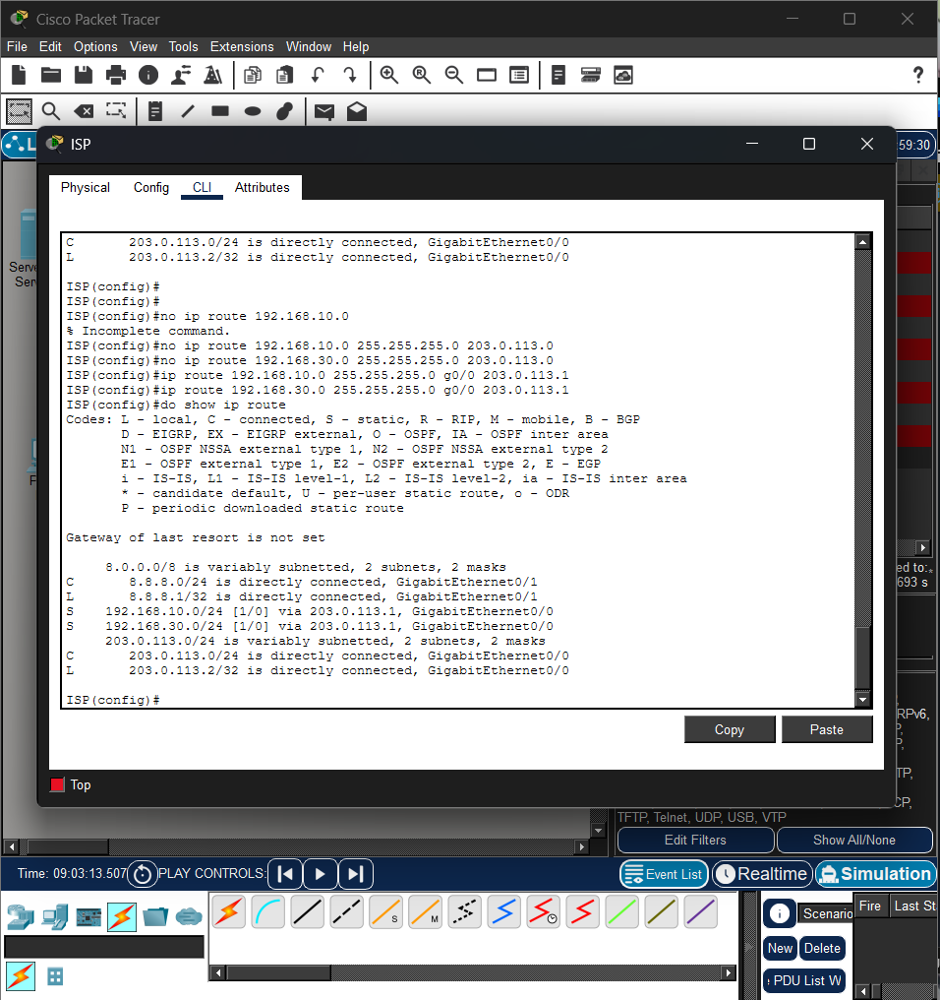
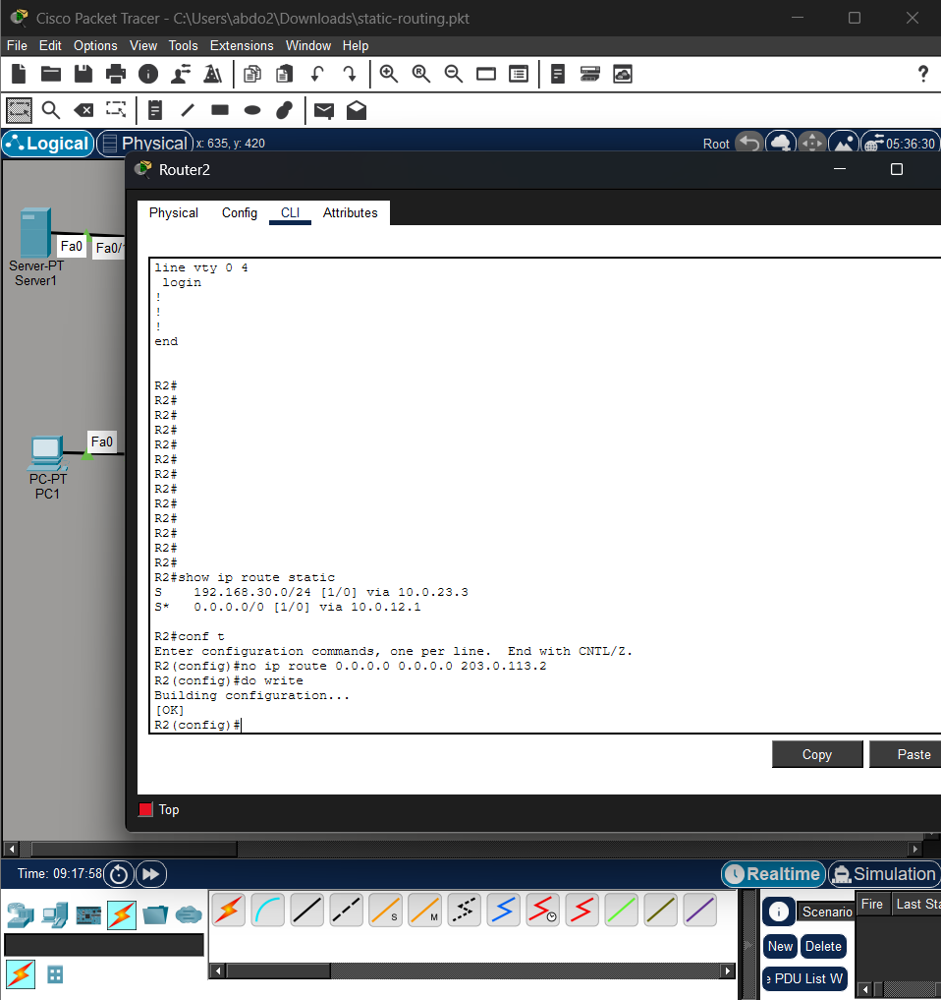

# Lab 01: Multi-Router Static & Default Routing



## Overview

I built a small network in Cisco Packet Tracer with four routers, two user LANs and a server standing in for "the internet." Then I set up static and default routes so every device could reach every other device. I made this while studying for the CCNA (Jeremy's IT Lab, Days 1–11). I wanted to put everything I'd covered so far into one network I designed myself, instead of only repeating the course labs.

**What it covers:** cabling, basic device security, IPv4 addressing, connected and local routes, static routes (three different formats), default routes, two-way reachability, and troubleshooting with `show` commands and Simulation mode.

---

## Topology

| Device | Role |
|---|---|
| **R1** | Edge router. Connects LAN A, R2 and the ISP |
| **R2** | Transit router between R1 and R3 |
| **R3** | Stub router for LAN B (only one way out) |
| **ISP** | Simulated internet provider, connected to the "internet" server |
| **SW1 / SW2 / SW3** | Access switches for LAN A, LAN B and the server network |
| **PC1 / PC2 / Server** | End hosts |

All links use copper straight-through cables. Router-to-router links work without crossovers because the 2911s support Auto MDI-X.

## IP Addressing

All networks are /24 (255.255.255.0).

| Device | Interface | IP Address | Default Gateway | Connects To |
|---|---|---|---|---|
| R1 | G0/2 | 192.168.10.1 | — | SW1 (LAN A) |
| R1 | G0/0 | 10.0.12.1 | — | R2 |
| R1 | G0/1 | 203.0.113.1 | — | ISP |
| R2 | G0/0 | 10.0.12.2 | — | R1 |
| R2 | G0/1 | 10.0.23.2 | — | R3 |
| R3 | G0/0 | 10.0.23.3 | — | R2 |
| R3 | G0/2 | 192.168.30.1 | — | SW2 (LAN B) |
| ISP | G0/0 | 203.0.113.2 | — | R1 |
| ISP | G0/1 | 8.8.8.1 | — | SW3 |
| PC1 | Fa0 | 192.168.10.10 | 192.168.10.1 | SW1 |
| PC2 | Fa0 | 192.168.30.10 | 192.168.30.1 | SW2 |
| Server | Fa0 | 8.8.8.8 | 8.8.8.1 | SW3 |

I numbered the router-link IPs so the last octet matches the router (`.1` = R1, `.2` = R2, `.3` = R3). That made it much easier to check next-hops at a glance.

---

## Routing Design

| Router | Route | Type | Why |
|---|---|---|---|
| R1 | 192.168.30.0/24 via 10.0.12.2 | Static | LAN B is behind R2 |
| R1 | 0.0.0.0/0 via 203.0.113.2 | Default | Everything else goes to the ISP |
| R2 | 192.168.30.0/24 via 10.0.23.3 | Static | LAN B is behind R3 |
| R2 | 0.0.0.0/0 via 10.0.12.1 | Default | LAN A and the internet are both toward R1 |
| R3 | 0.0.0.0/0 via 10.0.23.2 | Default | Stub router, only one way out |
| ISP | 192.168.10.0/24 G0/0 203.0.113.1 | Static (exit int + next-hop) | Return path to the customer's LAN A |
| ISP | 192.168.30.0/24 G0/0 203.0.113.1 | Static (exit int + next-hop) | Return path to the customer's LAN B |

**Why this mix of routes:**

- **R3 only needs a default route.** It sits at the end of the network, so every destination it doesn't already know is in the same direction.
- **R1 and R2 need both.** They have destinations in two directions. A default route can only point one way, so the "odd" direction (LAN B) gets a specific route, and everything else uses the default. Longest prefix match makes this work: traffic for 192.168.30.0/24 matches the /24 and never touches the /0.
- **The ISP has no default route on purpose.** R1 already points its default at the ISP. If the ISP pointed a default back at R1, any packet to an unknown address would bounce between them until its TTL ran out. A real ISP also only routes a customer's own networks to that customer, so it gets two specific routes instead.

---

## Build Steps

1. Placed and cabled all devices (straight-through everywhere)
2. Set hostnames, `enable secret` and `service password-encryption` on every router **and** switch
3. Configured router interfaces with IPs, descriptions and `no shutdown`
4. Configured static IPs and default gateways on the PCs and server, then tested each one by pinging its gateway
5. Pinged PC1 → PC2 **before** adding any routes, to confirm it fails (R1 replied "Destination host unreachable")
6. Added static routes toward LAN B on R1 and R2. The ping still failed, now with "Request timed out," because there was no return path yet
7. Added default routes on R1, R2 and R3. PC1 ↔ PC2 started working
8. Added the ISP's return routes so both LANs could reach the server
9. Verified everything (below) and saved all configs with `write`

---

## Verification

| Test | Result | TTL | Routers crossed |
|---|---|---|---|
| PC1 → PC2 | ✅ Success | 125 | 3 |
| PC2 → PC1 | ✅ Success | 125 | 3 |
| PC1 → Server (8.8.8.8) | ✅ Success | 126 | 2 |
| PC2 → Server (8.8.8.8) | ✅ Success | 124 | 4 |

The TTL values line up with the topology. Windows hosts start at 128, and every router subtracts 1, so the TTL is a quick way to count the hops.

**How the PC1 → PC2 ping changed as I built the routing:**

| Before any routes | Routes toward LAN B only | Default routes added |
|---|---|---|
|  |  |  |
| R1 has no route, so it replies *Destination host unreachable* | The packet reaches PC2, but the reply has no way back, so *Request timed out* | Two-way reachability, TTL=125 |

Example routing table on R1 after everything was configured:

```
Gateway of last resort is 203.0.113.2 to network 0.0.0.0

C     10.0.12.0/24 is directly connected, GigabitEthernet0/0
L     10.0.12.1/32 is directly connected, GigabitEthernet0/0
C     192.168.10.0/24 is directly connected, GigabitEthernet0/2
L     192.168.10.1/32 is directly connected, GigabitEthernet0/2
S     192.168.30.0/24 [1/0] via 10.0.12.2
C     203.0.113.0/24 is directly connected, GigabitEthernet0/1
L     203.0.113.1/32 is directly connected, GigabitEthernet0/1
S*    0.0.0.0/0 [1/0] via 203.0.113.2
```

Full configurations are in [`configs/`](configs/). The password hashes and device serial numbers have been removed.

---

## Issues I Ran Into (and How I Fixed Them)

Not everything worked the first time. These are the real problems I hit while building the lab.

### 1. Server rejected its subnet mask

**Symptom:** Packet Tracer showed *"Invalid IP for this subnet mask"* when I configured the server.
**Cause:** I had entered 255.255.255.255 (/32). That leaves no host bits, so it can't be used as a host's mask. I'd also left the default gateway at 0.0.0.0.
**Fix:** Changed the mask to 255.255.255.0 and set the gateway to 8.8.8.1.
**Takeaway:** /32 is only for single-address routes, like the router's own L (local) routes, never for a host's mask.



### 2. Wrong settings on the ISP's G0/0

**Symptom:** While checking my work, I noticed I'd typed G0/1's IP and description while I was in G0/0's interface mode.
**Found with:** `show ip interface brief` and `show running-config`
**Fix:** Re-entered the correct IP (203.0.113.2) and description on G0/0. A new description replaces the old one, so nothing had to be deleted first.
**Takeaway:** The `(config-if)#` prompt doesn't show which interface you're in, so I now always type `interface ...` right before configuring something.



### 3. Server pings failed because of a wrong next-hop on the ISP

**Symptom:** PC1 and PC2 still couldn't ping 8.8.8.8 after I added the ISP's return routes.
**Found with:** Simulation mode. The server's reply reached the ISP, the ISP sent out an ARP request, and nothing came back.
**Cause:** I had used **203.0.113.0** as the next-hop. That's the *network address* of the link, not R1's IP (203.0.113.1). No device owns a network address, so the ISP's ARP request never got an answer and it couldn't build a frame to send the reply.
**Fix:**
```
no ip route 192.168.10.0 255.255.255.0 203.0.113.0
no ip route 192.168.30.0 255.255.255.0 203.0.113.0
ip route 192.168.10.0 255.255.255.0 g0/0 203.0.113.1
ip route 192.168.30.0 255.255.255.0 g0/0 203.0.113.1
```
**Takeaway:** A next-hop has to be a real neighbour's interface IP, never a network (.0) or broadcast (.255) address.

| The wrong route | Tracing it in Simulation mode | After the fix |
|---|---|---|
|  |  |  |

### 4. A leftover default route on R2

**Symptom:** None. Every ping worked, and I only found this while reviewing the running-config before exporting it.
**Cause:** R2 had an extra `ip route 0.0.0.0 0.0.0.0 203.0.113.2`, which was R1's default route typed on the wrong router.
**Why it didn't break anything:** R2 isn't connected to 203.0.113.0/24, so it couldn't reach that next-hop, and IOS kept the route out of the routing table. `show ip route static` only showed the correct default.
**Why I removed it anyway:** If R2 ever learned a route to 203.0.113.0/24 (for example, after adding OSPF), the route would become active, and R2 would split traffic between two default routes. That would be a very confusing problem to track down later.
**Takeaway:** "It works" isn't the same as "it's correct." `show running-config` shows everything that's configured, while `show ip route` only shows what's actually in use, so it's worth checking both.



---

## What I Learned

- A router only automatically knows the networks plugged into its own **up/up** interfaces (C and L routes). Every other network needs a route, or the packet is dropped.
- Getting traffic to the destination is only half the job. The reply needs a route **back**, and the change in ping errors ("Destination host unreachable" → "Request timed out" → success) showed me exactly which half was broken.
- MAC addresses change at every router hop, but the source and destination IPs stay the same end to end.
- Default routes are great for stub and edge routers, but they can only point one way. Routers in the middle need specific routes for the other direction.
- Reading the routing table carefully matters: the code letter (C, L, S, S\*), the `[AD/metric]`, and the fact that the "variably subnetted" lines are headings, not routes.

## Future Improvements

- Configure **SSH** on the vty lines. They currently have `login` with no password, so remote access isn't possible at all.
- Replace the static routes with **OSPF** once I've covered it, and compare the two approaches.
- Build a separate **troubleshooting lab** with several faults planted on purpose, and document how I find each one.

---

## Files

| File | Description |
|---|---|
| `static-routing.pkt` | Packet Tracer file (Packet Tracer 8.x) |
| `topology.png` | Network diagram |
| `configs/` | Running configs for R1, R2, R3 and the ISP |
| `screenshots/` | Every step of the build, numbered in order (see below) |

### Screenshot index

| # | What it shows |
|---|---|
| 01–02 | Devices placed and cabled, before any configuration (all router links red) |
| 03 | Hostname, `enable secret` and password encryption on R1 |
| 04–08 | Router interfaces going from administratively down to up/up |
| 09–11 | ISP interfaces, including the mistake I caught and fixed |
| 12 | Every link green after all interfaces were configured |
| 13 | R1 with all 6 connected and local routes |
| 14–17 | Host IP settings, the server mask error, and gateway pings with `arp -a` |
| 18–19 | Ping failing before any routes, and R1's table with no route to LAN B |
| 20–22 | Static routes on R1 and R2, and the ping still failing (no return path) |
| 23–26 | Default routes on R3, R2 and R1, and the first successful PC1 → PC2 ping |
| 27–32 | ISP return routes, the wrong next-hop issue, and successful pings to the server |
| 33 | PC2 → PC1 traced hop by hop in Simulation mode |
| 34–35 | The inactive stray route on R2, found and removed |
| 36 | R1's final routing table, saved with `write` |
